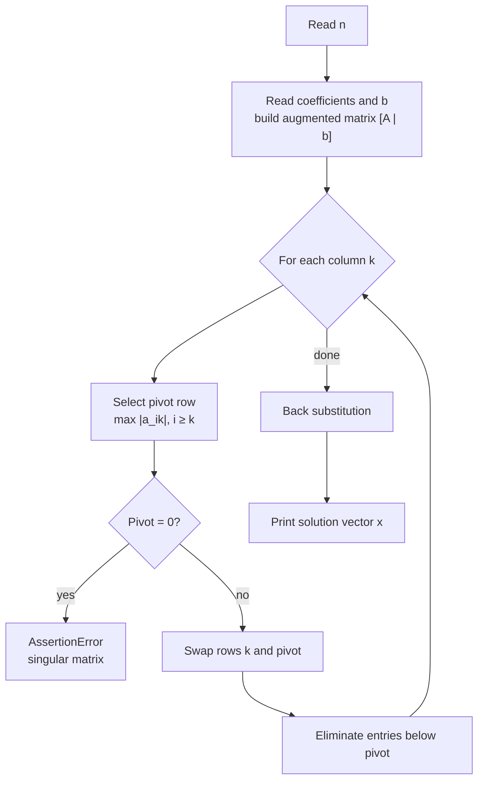

<div align="center">
  
  <p><b>A dependency-free Python reference implementation of Gaussian elimination with partial pivoting for solving Ax = b.</b></p>
  <p>
    
    
    
    <a href="LICENSE"></a>
    
    
    <a href="https://github.com/ismailbentabett/gauss-elimination-method/stargazers"></a>
    
  </p>
  <p><a href="#-quick-start">Quick start</a> · <a href="#-features">Features</a> · <a href="#-architecture">Architecture</a> · <a href="#-contributing">Contributing</a></p>
</div>

## Overview

**Gauss Elimination** is a compact command-line solver for square systems of linear equations. It reads the coefficient matrix and right-hand side interactively, reduces the augmented matrix to upper-triangular form using Gaussian elimination with partial pivoting, and recovers the solution vector by back substitution. Written in pure Python with no third-party libraries, it is a numerical-methods learning project and a readable reference for how the algorithm works step by step.

## ✨ Features

- **Interactive input** – prompts for the system size *n*, then each coefficient `matrix[i][j]` and right-hand-side value `b[0][i]`.
- **Augmented-matrix workflow** – stores the system as an *n × (n + 1)* matrix `[A | b]`.
- **Partial pivoting** – at each step the row with the largest absolute pivot is swapped into place to improve numerical stability.
- **Singularity guard** – an assertion stops the solve when no non-zero pivot exists in the current column.
- **Forward elimination** – zeroes the entries below each pivot in place.
- **Back substitution** – solves the resulting upper-triangular system and prints the solution vector.
- **Zero dependencies** – runs on any standard Python 3 installation.

## 📐 The math

Given a system of *n* linear equations in *n* unknowns,

$$
A\mathbf{x} = \mathbf{b}, \qquad A \in \mathbb{R}^{n \times n},\; \mathbf{b} \in \mathbb{R}^{n}
$$

the solver works on the augmented matrix $[A \mid \mathbf{b}]$.

**1. Partial pivoting.** For each column $k = 1, \dots, n$, choose the pivot row

$$
p = \arg\max_{i \ge k} \lvert a_{ik} \rvert
$$

and swap rows $p$ and $k$. If $a_{pk} = 0$, the matrix is singular.

**2. Forward elimination.** For every row $i > k$, compute the multiplier and update the row:

$$
m_{ik} = \frac{a_{ik}}{a_{kk}}, \qquad a_{ij} \leftarrow a_{ij} - m_{ik}\, a_{kj} \quad (j = k+1, \dots, n+1)
$$

After all $n$ steps the system is upper triangular, $U\mathbf{x} = \mathbf{c}$.

**3. Back substitution.** Solve from the last row upwards:

$$
x_i = \frac{1}{u_{ii}} \left( c_i - \sum_{j=i+1}^{n} u_{ij}\, x_j \right), \qquad i = n, n-1, \dots, 1
$$

### Complexity

| Phase               | Arithmetic cost                  | Order        |
|---------------------|----------------------------------|--------------|
| Forward elimination | $\approx \tfrac{2}{3} n^3$ flops | $O(n^3)$     |
| Back substitution   | $\approx n^2$ flops              | $O(n^2)$     |
| **Total**           |                                  | **$O(n^3)$** |

Memory is $O(n^2)$: the augmented matrix is reduced in place.

## 🧱 Tech stack

| Layer      | Technology                                   |
|------------|----------------------------------------------|
| Language   | Python 3 (standard library only)             |
| Interface  | Command line, interactive `input()` prompts  |
| Algorithm  | Gaussian elimination with partial pivoting   |
| Data model | Nested Python lists (augmented matrix)       |

## 🏗 Architecture



| Function | Responsibility |
|----------|----------------|
| `gauss(matrix, RowSize, matrixSize)` | Partial pivoting, forward elimination and back substitution; returns the solution list `x`. |
| `swp(matrix, matrixSize, RowSize)` | Legacy column-swap helper, invoked only when a diagonal entry is exactly zero before pivot selection. |

## 🚀 Quick start

### Prerequisites

- Python 3 (verified with Python 3.14; the script uses only built-in features).

### Run

```bash
git clone https://github.com/ismailbentabett/gauss-elimination-method.git
cd gauss-elimination-method
python ismail_guass.py      # use python3 on macOS / Linux if needed
```

### Example

Solve the classic system

$$
\begin{aligned}
2x + y - z &= 8 \\
-3x - y + 2z &= -11 \\
-2x + y + 2z &= -3
\end{aligned}
$$

Enter the size, then each row's coefficients followed by its right-hand side:

```text
Enter  the size of matrix   : 3
Enter the entries row size  :
matrix[0][0]=2
matrix[0][1]=1
matrix[0][2]=-1
b[0][0]=8
matrix[1][0]=-3
matrix[1][1]=-1
matrix[1][2]=2
b[0][1]=-11
matrix[2][0]=-2
matrix[2][1]=1
matrix[2][2]=2
b[0][2]=-3
[2.0, 3.0000000000000004, -0.9999999999999999]
```

The result corresponds to $x = 2,\; y = 3,\; z = -1$; the tiny deviations are normal IEEE-754 floating-point rounding.

You can also pipe input non-interactively:

```bash
printf '3\n2\n1\n-1\n8\n-3\n-1\n2\n-11\n-2\n1\n2\n-3\n' | python ismail_guass.py
```

## ⚙️ Configuration

No configuration, environment variables or external services are used. Note that inputs are parsed with `int()`, so coefficients must currently be whole numbers.

## 📁 Project structure

```
gauss-elimination-method/
├── ismail_guass.py   # Solver entry point: input, gauss(), swp(), output
├── temp.py           # Earlier draft of the solver kept for history (not the entry point)
├── LICENSE
└── .github/          # Branding assets, issue and PR templates
```

## 🗺 Roadmap

- [x] Gaussian elimination with partial pivoting and back substitution
- [x] Interactive command-line input
- [ ] Accept decimal coefficients (`float` input) and validate input
- [ ] Wrap the solver in an importable function / module with a `__main__` guard
- [ ] Read systems from a file or command-line arguments
- [ ] Replace assertions with clear error messages for singular systems
- [ ] Add unit tests comparing results against `numpy.linalg.solve`
- [ ] Optional step-by-step output of each elimination stage

## 🤝 Contributing

Contributions are welcome. Please read [CONTRIBUTING.md](CONTRIBUTING.md) for the workflow, branch naming and commit conventions, and follow the [Code of Conduct](CODE_OF_CONDUCT.md).

## 🔒 Security

Please report vulnerabilities privately as described in [SECURITY.md](SECURITY.md). Do not open public issues for security problems.

## 📄 License

Released under the [MIT License](LICENSE).

---

<div align="center">
  <p>Built by <b>Ismail Bentabett</b> · <a href="https://github.com/ismailbentabett">GitHub</a> · <a href="https://ismailbentabett.com">ismailbentabett.com</a></p>
  <p>⭐ Star this repo if you find it useful</p>
</div>
